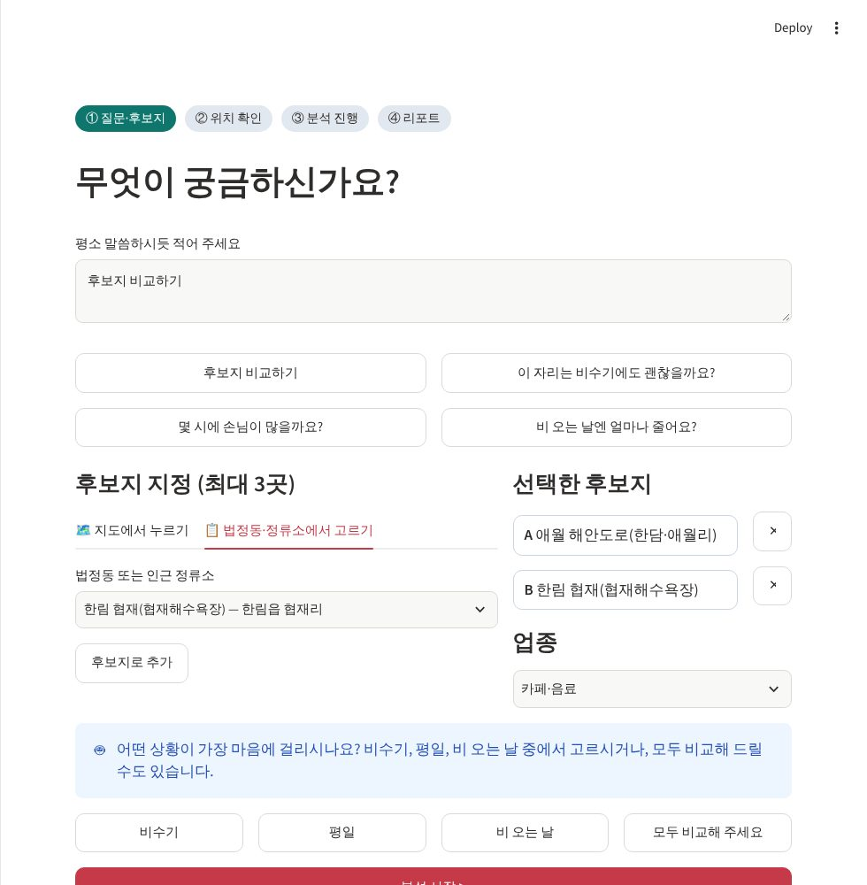
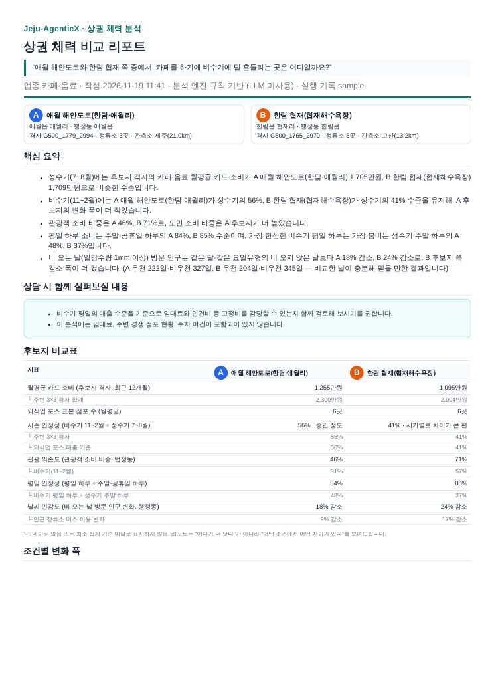
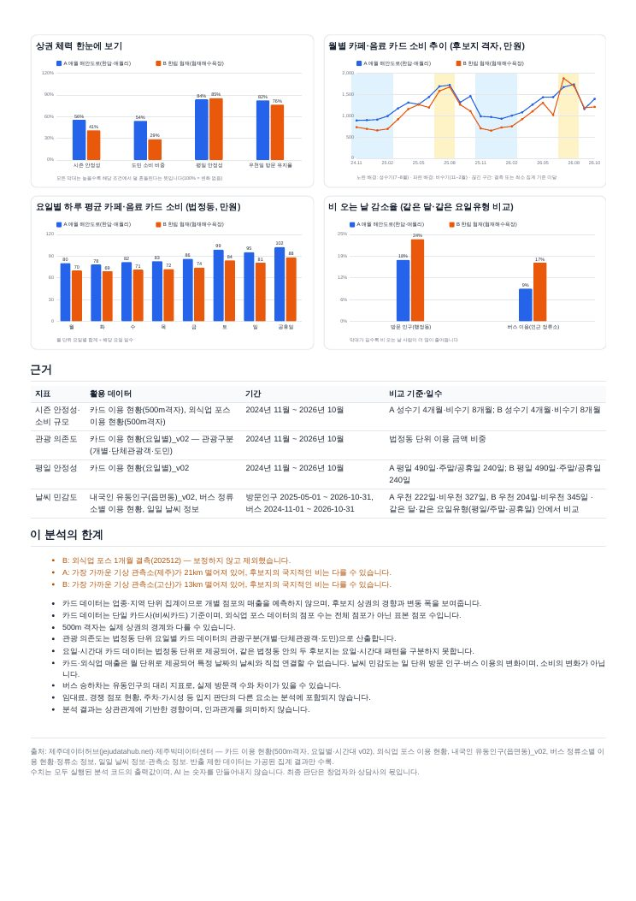

# Jeju-AgenticX 결과 설명자료

**제주에서 창업을 준비하는 도민과 그 곁의 상담사를 위한 상권 체력 분석 AI Agent**
[데이콘] 제주 AI·빅데이터 활용 AI Agent 개발 챌린지 · 팀 에이전틱스 · 2026년 11월

---

## 1. 문제 정의

제주의 창업은 성수기의 풍경을 보고 결정하지만, 비수기의 일상을 견디며 유지됩니다.
“이 자리는 비수기 평일에도 버틸 수 있는가”, “궂은 날씨가 이어지면 손님은 얼마나 줄어드는가”에 답할 데이터
(500m 격자 카드 소비, 요일·시간대 카드 소비, 읍면동 유동인구, 정류소별 버스 이용, 일일 날씨)는 이미 공개되어 있지만,
세 가지 장벽 때문에 창업 현장에 닿지 못하고 있습니다.

| 장벽 | 어려움 | 담당 Agent |
|---|---|---|
| 선택의 장벽 | 질문에 어떤 데이터를 어떻게 조합할지 알기 어렵다 | ② Navigator |
| 처리의 장벽 | 주소를 격자·정류소·관측소에 연결하고 결합하려면 코딩·공간정보 역량이 필요하다 | ③ Analyst |
| 해석의 장벽 | 수치를 얻어도 판단으로 잇기 어렵고, 믿을 만한 차이인지 가늠하기 어렵다 | ④ Critic · ⑤ Reporter |

## 2. 구조

```
사용자 질문 ─▶ ① Planner ─▶ ② Navigator ─▶ ③ Analyst ─▶ ④ Critic ─(통과)─▶ ⑤ Reporter
               (ask_user)                     ▲             │
                                              └─ 재분석 요청 ─┘ (최대 2회)
```

- **오케스트레이션**: LangGraph 상태 그래프. Critic → Analyst 재분석 루프는 조건부 간선으로 구현.
- **수치 원칙**: 모든 수치는 샌드박스에서 실행된 코드(pandas/DuckDB)가 계산합니다. LLM 은 계획·코드 작성·문장 다듬기만 하며,
  LLM 문장의 수치가 코드 산출값과 하나라도 대조되지 않으면 그 문장을 버립니다.
- **3가지 실행 모드**: 외부 LLM(기본) · 로컬 모델(오프라인, Qwen2.5-3B Q4) · 규칙 기반(LLM 없이). Key 가 없어도 전체 기능이 동작합니다.
- **분석 코드**: 표준 지표는 검증된 템플릿에 위치 연결 결과를 채워 생성하고, 템플릿이 없는 질문은 LLM 이 컬럼 구조만 보고 작성 → 실행 → 오류 시 최대 3회 자가 수정.

| 상권 체력 지표 | 정의 | 데이터(단위) |
|---|---|---|
| 시즌 안정성 | 비수기(11~2월) 월평균 ÷ 성수기(7~8월) 월평균 | 카드(500m격자)·외식업 포스 — 월 |
| 관광 의존도 | 관광객(개별+단체) 소비 비중 | 카드(요일별)_v02 — 법정동·월 |
| 평일 안정성 | 평일 하루 ÷ 주말·공휴일 하루 (요일 일수로 나눈 하루 평균) | 카드(요일별)_v02 — 법정동·월 |
| 날씨 민감도 | 같은 달·같은 요일유형 안에서 우천일 ÷ 비우천일 − 1 (가중평균) | 유동인구(읍면동)_v02, 버스 × 일일 날씨 — 일 |

## 3. 실행 결과 (예시 데이터)

> 반출 제한 데이터는 센터 밖에서 확보할 수 없어 명세서와 같은 구조의 **예시 데이터**로 동작을 검증했습니다.
> 아래 수치는 실제 상권 실적이 아닙니다. `JEJU_DB_PATH` 만 바꾸면 센터 PC 에서 실데이터로 같은 흐름이 동작합니다.

시나리오: 카페 창업을 준비하는 도민이 상담사와 함께 “애월 해안도로와 한림 협재 쪽 중에서, 카페를 하기에 비수기에 덜 흔들리는 곳은 어디일까요?”라고 묻고,
Agent 의 “어떤 상황이 가장 마음에 걸리시나요?” 질문에 “모두 비교해 주세요”를 고른 경우.



Agent 가 만든 핵심 요약(코드 산출값 그대로):

- 성수기(7~8월)에는 두 후보지 격자의 카페 월평균 카드 소비가 1,705만원, 1,709만원으로 비슷합니다.
- 비수기(11~2월)에는 A 애월이 성수기의 56%, B 한림 협재가 41% 수준을 유지해 A 의 변화 폭이 더 작았습니다.
- 관광객 소비 비중은 A 46%, B 71% — 도민 소비 비중은 A 가 더 높았습니다.
- 비수기 평일 하루는 성수기 주말 하루의 A 48%, B 37%입니다.
- 비 오는 날 방문 인구는 A 18%, B 24% 감소(우천 222·204일 vs 비우천 327·345일 비교 — 믿을 만한 결과).





## 4. 검증과 한계

### 4.1 Critic 이 실제로 한 일 (예시 실행에서)
- **결측 표시**: 한림 협재 격자의 외식업 포스 2025년 12월 결측 → 보정하지 않고 제외, 한계로 명시
- **격자 경계**: 애월 후보지가 격자 경계에서 55m → 주변 3×3 격자 값 병기
- **관측소 거리**: 가장 가까운 관측소가 21km·13km → “국지적인 비는 다를 수 있음” 표시
- **연도 효과 재분석**: 월정리·함덕 질문에서 연도별 성수기 규모 차이(10% 초과)를 감지 → 같은 시즌연도(2025년 여름 ↔ 2025/26 겨울)끼리 재분석
- **같은 집계 단위**: 월정리·세화처럼 같은 행정동인 후보지는 “방문인구 기준 날씨 민감도는 같다”를 표시하고 버스 지표로 보완

### 4.2 기준 질문 세트 (20문항)
정답은 Agent 의 분석 템플릿과 **별도로 작성한 pandas 구현**(`eval/build_reference.py`)으로 계산했습니다.

| 항목 | 결과 |
|---|---|
| 계획 정확도(후보지·업종·지표) | 20/20 |
| 데이터 선택 정확도 | 20/20 |
| 수치 정확도(±0.001) | 43/43 |
| 재현성(`tools.replay`) | 저장 코드 재실행 결과 일치 |
| 단위·통합 테스트 | 17/17 통과 (샌드박스 차단, 수치 불일치 LLM 문장 폐기, 코드 자가 수정 포함) |

유의: 기준 질문은 개발팀이 작성했으므로, 처음 보는 표현의 질문 이해력은 센터 시범 운영에서 실제 질문으로 추가 측정합니다.

### 4.3 분석의 한계 (리포트에 자동 안내)
- 개별 점포 매출을 예측하지 않습니다. 업종·지역 집계의 경향과 변동 폭을 보여줍니다.
- 카드·외식업 매출은 월 단위라 날씨와 직접 연결하지 않습니다. 날씨 민감도는 **방문 인구**의 변화입니다.
- 요일·시간대 카드 데이터는 법정동 단위 — 같은 법정동의 두 후보지는 구분하지 못합니다.
- 카드 데이터는 단일 카드사 기준, 외식업 포스 점포 수는 표본 점포 수입니다.
- 내국인 유동인구(읍면동)_v02 는 2025년 5월부터 제공됩니다.
- 임대료·경쟁 점포·주차·가시성은 포함하지 않습니다. 결과는 상관관계에 기반한 경향입니다.

## 5. 센터 활용 방안

- **상권 분석 자가 진단 창구**: 큰 글씨·예시 버튼·지도 선택으로 데이터에 익숙하지 않은 도민도 이용
- **상담 준비 부담 경감**: 상담사가 후보지 2~3곳 비교 리포트를 몇 분 안에 준비, PDF 로 창업자에게 전달
- **반출 제한 데이터의 안전한 활용**: 오프라인 모드에서 원본은 센터 PC 밖으로 나가지 않고 집계 결과만 리포트에 수록
- **데이터 수요 파악**: `runs/` 에 쌓이는 질문·분석 기록으로 센터 데이터 수요와 신규 개방 우선순위 근거 마련
- **효과 검증 계획**: 시범 운영 시 질문 해결률, 상담 준비 시간 변화, 사용자 만족도, 상담사 재이용률 측정

## 6. 실행 환경 적합성

| 센터 PC 최소 사양 | 대응 |
|---|---|
| i7-8700 / RAM 32GB | DuckDB 단일 파일(예시 약 10MB), 지표별 분석 1초 내외 |
| GTX 1060 / VRAM 3GB | 로컬 모델 3B·4bit 양자화(Ollama) |
| 설치·실행 | `install.bat` 1회 → 바탕화면 `Jeju-AgenticX 실행` |
| 인터넷 미연결 | 규칙 기반·오프라인 모드, 지도 대신 법정동·정류소 목록 선택 |

## 7. AI 활용 내역

- 서비스 내: 외부 LLM API(Anthropic Claude), 오프라인 Qwen2.5-3B-Instruct(Ollama) — 질문 해석 보조, 자유 질문 코드 작성·수정, 요약 문장 다듬기. 수치 계산에는 사용하지 않음.
- 개발 과정: Claude Code 를 코드 작성 보조에 활용.
- 오픈소스: pandas, numpy, DuckDB, LangGraph, Streamlit, folium, Jinja2 등 (라이선스는 README 참조).
